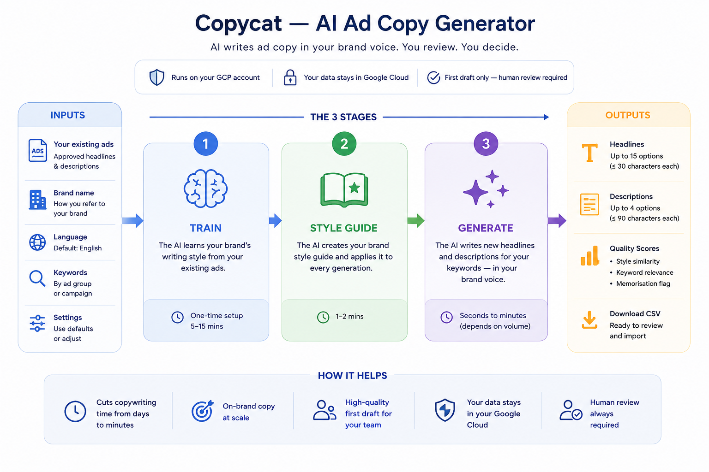

# Copycat — AI Ad Copy Generator
### What it does, what you put in, and what you get out

---

## What is this?

Copycat is an AI tool that writes Google Search Ads (headlines and descriptions) **in your brand's own voice**, using your existing ads as a style reference.

You give it a library of ads that have already been approved and used. It learns the tone, structure, and vocabulary your brand uses. Then, when you give it a new set of keywords, it writes new ad copy that sounds like it came from the same team that wrote your originals — not like a generic AI prompt.

It uses **Google's Gemini AI** (the same model family behind Bard / Google AI) running on your own GCP account. Your data stays in your Google Cloud environment and is not shared.

---

## What problem does it solve?

Writing RSA (Responsive Search Ad) copy at scale is time-consuming. Each ad group needs:
- Up to **15 headlines** (30 characters max each)
- Up to **4 descriptions** (90 characters max each)

Multiply that by dozens or hundreds of ad groups, and you're looking at days of copywriting work per campaign refresh. Copycat reduces that to minutes.

The output isn't final copy — it's a **high-quality first draft**, reviewed and edited by the team before going live.

---

## The Three Stages

### Stage 1 — Train (one-time setup)

You upload your existing Google Ads. The system reads through all your approved headlines and descriptions, understands your brand's writing style, and saves a model.

This is a one-time step per brand. Once trained, the model is saved and reused for every generation run — you don't retrain unless your brand's ad library changes significantly.

**Time:** 5–15 minutes (depends on how many ads you have)

---

### Stage 2 — Style Guide (recommended)

The AI reads through your exemplar ads and writes a brand style guide: what tone to use, what to avoid, how you refer to your products, what makes your copy distinctive.

This guide is automatically attached to every generation request so the AI stays on-brand without you having to re-explain your style each time.

**Time:** 1–2 minutes

---

### Stage 3 — Generate

You provide a list of keywords (by ad group or campaign). The system:

1. Finds the most similar existing ads from your library as style references
2. Combines those with the style guide
3. Asks Gemini to write new headlines and descriptions matching that style
4. Returns the copy, along with quality scores

**Time:** A few seconds to a few minutes depending on the number of ad groups

---

## What you put in

### Training data (your existing ads)

A spreadsheet of your existing Google Ads — the ones that represent your brand well. These are the style examples the AI learns from.

The file should include the keywords for each ad group, plus the headlines and descriptions.

| What you need | Why |
|---|---|
| At least 20 ads | Fewer than this and the AI doesn't have enough style examples to learn from |
| 50–200 ads | Sweet spot — good style variety without noise |
| Approved, on-brand ads only | Bad examples = bad output |

---

### Company / brand name

Used by the AI when writing the style guide and generating copy. Should match how you refer to the brand in your ads.

Example: `Acme Scooter 125`, `Samsung UK`, `Currys`

---

### Language

The language your ads should be written in. Default is English.

---

### Keywords (for generation)

The keywords you want ads written for. These can be provided as:

- A simple list (one ad group per line, related keywords comma-separated)
- A structured CSV with Campaign, Ad Group, and Keyword columns (matches your Google Ads account structure)

Example simple list:
```
acme scooter 125, 125cc scooter, scooter price
honda activa alternative, fuel efficient scooter
```

---

### Generation settings (optional — defaults work well)

These are adjustable but the defaults are sensible for most use cases.

| Setting | What it means | Default |
|---|---|---|
| **Versions per ad group** | How many alternative ad variants to generate (useful for A/B testing) | 1 |
| **Use style guide** | Whether to include the generated style guide in the AI prompt | On |
| **Allow copied copy** | Whether to accept output that's identical to training examples (almost always: no) | Off |
| **AI creativity** (temperature) | How varied and creative the output is. Lower = safer and more consistent. | Balanced |
| **Reference ads per request** | How many of your existing ads the AI looks at per generation | 5 |

---

## What you get out

For each ad group / keyword set, you receive:

### Headlines
Up to 15 headline options, each under 30 characters. These are ready to copy into Google Ads as RSA headlines.

### Descriptions
Up to 4 description options, each under 90 characters.

### Quality scores

| Score | What it tells you |
|---|---|
| **Style similarity** | How closely the output matches your brand's writing style (0–1, higher is better) |
| **Keyword relevance** | How well the copy covers the input keywords (0–1, higher is better) |
| **Memorisation flag** | Whether the AI copied anything verbatim from your training ads (should be: No) |

Results are downloadable as a CSV, ready to import into Google Ads or share with the team for review.

---

## What this tool does NOT do

- It does **not** publish anything to Google Ads automatically. All output requires manual review before going live.
- It does **not** send your ad data outside your Google Cloud account.
- It does **not** guarantee legal compliance, trademark clearance, or policy compliance — that review stays with the team.
- It is **not** a replacement for a copywriter — it's a first-draft accelerator.

---

## Example output

**Input keywords:** `acme scooter 125, 125cc scooter, best 125cc bike`

**Generated headlines:**
- Acme Scooter 125 — Official
- Best 125cc Scooter in India
- Fuel-Smart. Style-Forward.
- Test Ride Today
- Easy EMI Options Available

**Generated descriptions:**
- Discover the Acme Scooter 125 — the smarter, stylish 125cc scooter built for everyday journeys.
- Exceptional mileage. Sleek design. Book your Acme Scooter 125 test ride now.

**Quality:** Style 0.96 · Keyword 0.88 · Not memorised ✓

---

## Summary

| | |
|---|---|
| **Best for** | Scaling RSA copy production across many ad groups or campaigns |
| **Input** | Your existing approved ads + new keywords |
| **Output** | Headlines + descriptions in your brand voice, with quality scores |
| **Effort** | One-time training setup; then generate on demand in minutes |
| **Human review** | Always required before going live |
| **Data stays in** | Your Google Cloud project |
